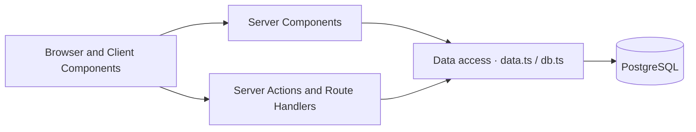

# Dashboard architecture

**Browser and Client Components.** The browser displays the dashboard and handles interactive search and form state. Client Components submit forms to Server Actions and use URL parameters for search and pagination.

**Server Components.** Pages under `app/dashboard/` render the overview, lists, and record details on the server. They call read functions in `app/lib/data.ts` and pass the results to UI components.

**Server Actions and Route Handlers.** Actions in `app/lib/actions.ts` validate forms, update records, and refresh affected pages. Route handlers provide HTTP entry points, including the Auth.js endpoint.

**Data access.** `app/lib/data.ts` assembles read queries and translates results for the UI. The shared PostgreSQL client lives in `app/lib/db.ts` and is also used by the current write actions.

**Database.** PostgreSQL stores customer records, invoices, and credential accounts. The customer integrity migration adds case-insensitive email uniqueness and enforces the invoice-to-customer relationship.

## Environments

| Environment | URL | Database | Environment variables | Users |
| --- | --- | --- | --- | --- |
| Local | http://localhost:3000 | Developer database | `DATABASE_SESSION_URL`, `AUTH_SECRET`, optional OAuth pairs | Developers |
| Preview | Per-PR Vercel URL | Separate preview database | Same keys with preview credentials | Review partner and tester |
| Production | https://david-test-ivory.vercel.app/ | Production PostgreSQL | Same keys with production credentials | Dashboard users |

## Schema changes

Put each change in a new timestamped SQL file under `supabase/migrations/`. Run `supabase start` and `supabase db reset --local` from the repository root to apply the migrations and load test fixtures. A local reset replaces data in the local Supabase database.

Review the SQL and run it against the preview database before production. On the existing hosted database, confirm its schema, migration history, and server database role before applying the baseline. Check for duplicate customer emails and orphan invoices as described in the customer integrity migration. Back up production, review the linked migration dry run, and apply only the reviewed migrations. Keep `supabase/seed.sql` local by omitting the hosted seed option.

## Lifecycle

- For major Next.js upgrades, read the release notes, upgrade on a branch, and verify sign-in, data writes, and the production build in preview before merging.
- Schedule database backups according to the hosting plan. Test a restore on a separate database and record the date and result.
- Inspect Vercel and PostgreSQL logs for repeated errors and connection failures. Keep secrets, credentials, and customer data out of application logs.
- On retirement, export records the owner needs to retain, disable deployments and sign-in callbacks, revoke credentials, and delete remaining data according to the applicable retention policy.
